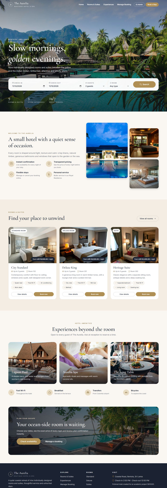
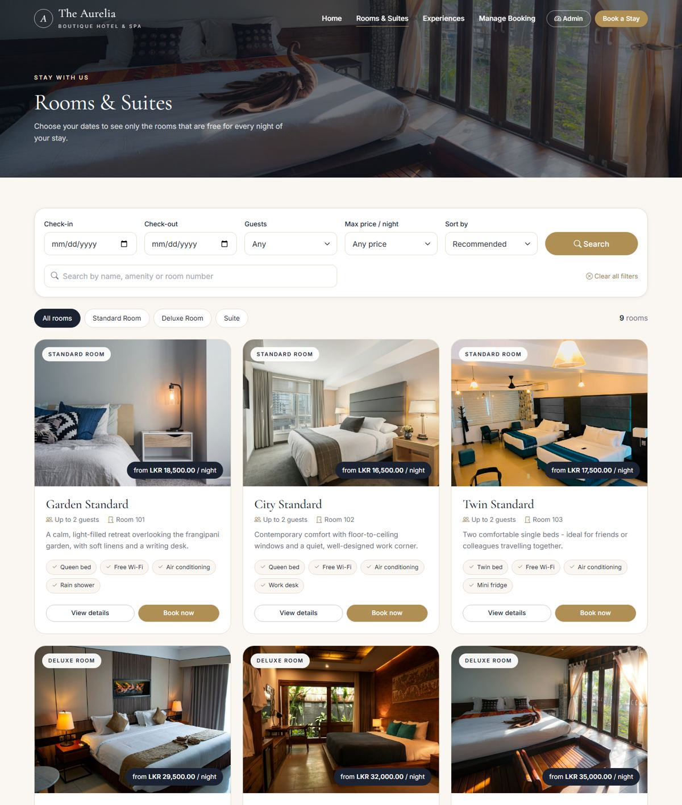
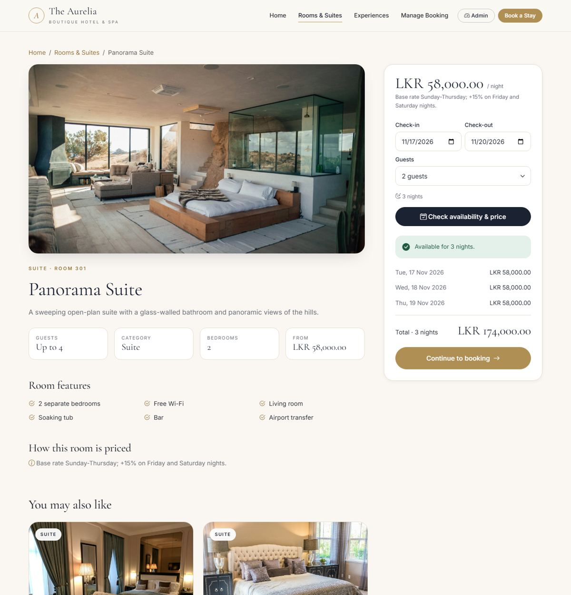
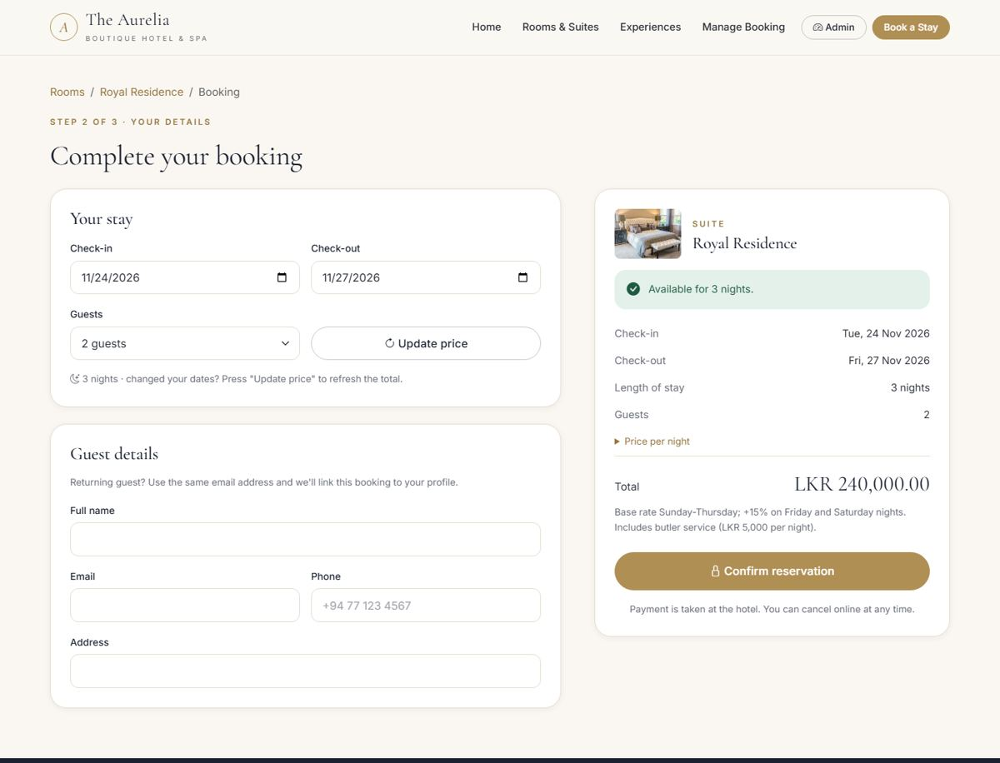
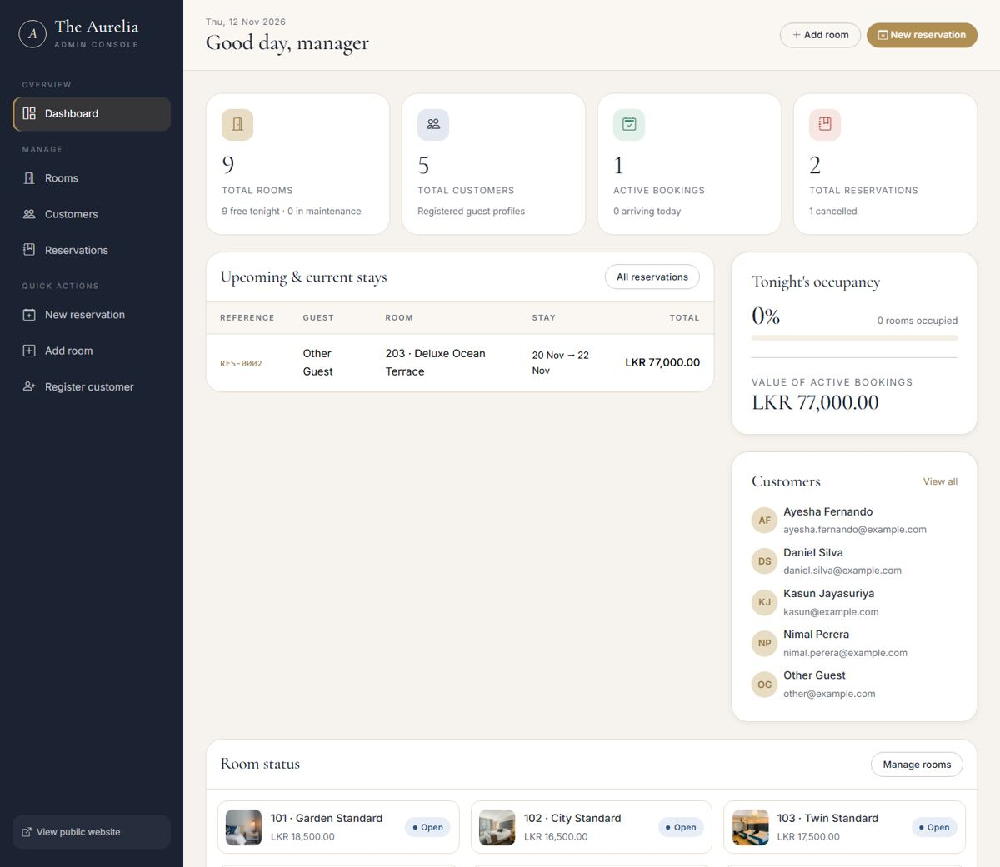
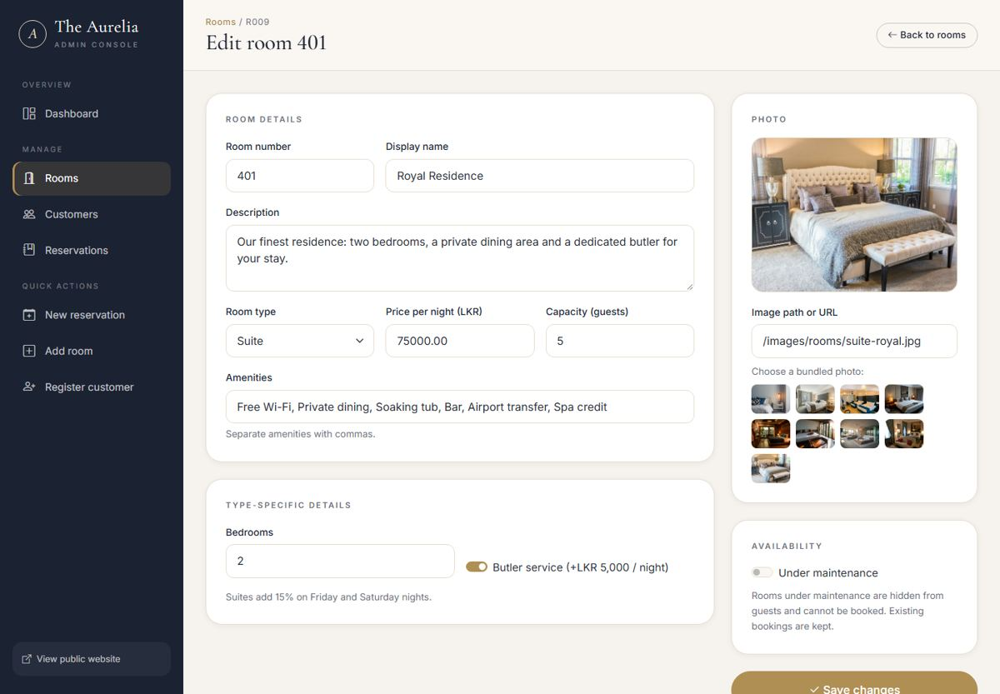
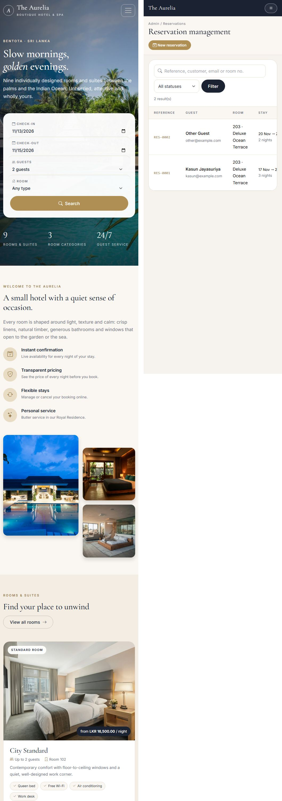

# The Aurelia — Hotel Room Reservation System

**SE1020 Object-Oriented Programming project** · Java 21 · Spring Boot 3.5 · Thymeleaf · Bootstrap 5 · MySQL

A web-based hotel reservation system for a fictional boutique hotel, "The Aurelia". Guests can browse rooms, check real availability for their dates, see the exact price of every night, book a room and later look up or cancel their booking. Administrators manage rooms, customers and reservations from a dashboard.

The project focuses on **object-oriented design in Java**: an abstract `Room` class with three subclasses that each price a night differently, encapsulated entities with validating setters, repository interfaces that hide the SQL, and a layered Controller → Service → Repository → MySQL architecture.

---

## 1. Main features

| Module | What it does |
|---|---|
| **Room management** | Add, view, search, filter (type, price, guests), edit, delete rooms. Three room types (Standard, Deluxe, Suite) with type-specific details. Rooms can be put under maintenance. |
| **Customer management** | Register, view (with booking history), search, edit and delete customers. Email, phone and name validation; duplicate emails are rejected. |
| **Reservation management** | Create (guest website or admin), view, search, edit, cancel and delete reservations. Real date-overlap checking prevents double booking; totals are calculated automatically with `BigDecimal`. |
| **Guest website** | Home page with availability search, room catalogue with filters, room details with per-night price breakdown, booking form, confirmation page, "Manage booking" (lookup + cancel). |
| **Accounts & sign-in** | Guests register and sign in with email and password. **My bookings** lets them view, edit (dates and guests, with the price recalculated), cancel and delete their own bookings, and update their profile. Administrators sign in separately with a username and password stored in their own `admins` table. Passwords are stored as BCrypt hashes. |
| **Admin dashboard** | Overview cards (rooms, customers, active bookings, reservations), tonight's occupancy, upcoming stays, room status, and full CRUD tables with search and confirmation dialogs. |
| **Persistence** | MySQL database `hotel_reservation` with tables `rooms`, `room_amenities`, `customers` and `reservations`, accessed with plain SQL through Spring `JdbcTemplate`. |

### Booking rules (enforced in `ReservationService`)
- Room and customer must exist.
- Check-out must be after check-in; check-in cannot be in the past; at most 30 nights.
- Guests must be between 1 and the room's capacity.
- Rooms under maintenance cannot be booked.
- Two **confirmed** stays in the same room conflict when `newCheckIn < existingCheckOut && newCheckOut > existingCheckIn`. Check-out is exclusive, so a new guest may arrive on the day the previous guest leaves.
- Cancelled reservations never block a room.

### Pricing rules (polymorphism)
| Room type | Nightly rate |
|---|---|
| `StandardRoom` | base price every night |
| `DeluxeRoom` | base price; **+10%** on Friday and Saturday nights |
| `SuiteRoom` | base price; **+15%** on Friday and Saturday nights; **+LKR 5,000** per night with butler service |

## 2. Technology stack
- **Backend:** Java 21, Spring Boot 3.5.7 (Spring Web MVC, Validation), Maven
- **Views:** Thymeleaf server-side templates
- **Frontend:** HTML5, CSS3, vanilla JavaScript, Bootstrap 5.3.3 and Bootstrap Icons 1.11.3 (stored locally in `static/vendor`, so the site works offline)
- **Fonts:** Cormorant Garamond and Inter (Google Fonts; falls back to Georgia/system fonts when offline)
- **Database:** MySQL 8 (driver `mysql-connector-j`), plain SQL via Spring JDBC (`JdbcTemplate`), schema in `src/main/resources/schema.sql`
- **Test database:** H2 in-memory, MySQL compatibility mode (tests only)
- **Tests:** JUnit 5, AssertJ, Spring MockMvc

## 3. Setup requirements
- JDK **21 or newer** (developed and tested with JDK 23, compiled with `--release 21`)
- Apache Maven 3.9+
- **MySQL Server 8** (MySQL Installer, or XAMPP's MySQL/MariaDB) running on `localhost:3306`
- Internet access the first time Maven downloads dependencies
- VS Code with the *Extension Pack for Java* (recommended in `.vscode/extensions.json`)

## 4. How to run

### Step 1 — Prepare MySQL (once)
1. Install **MySQL Server 8** and start it (it listens on port 3306).
2. Give the application your MySQL login. Either:
   - copy `application-local.properties.example` to **`application-local.properties`** in the project folder and enter your password there (this file is git-ignored), **or**
   - set the environment variables `DB_USERNAME` and `DB_PASSWORD`.

You do **not** need to create the database or tables yourself. The connection URL contains `createDatabaseIfNotExist=true`, and `schema.sql` creates the tables at start-up (`CREATE TABLE IF NOT EXISTS`, so existing data is never touched).

### Step 2 — Run the application
**In VS Code:** open **Run and Debug**, choose **"Run Hotel Reservation System"** (or click **Run** above `main` in `HotelReservationApplication.java`).
**In IntelliJ IDEA:** *File → Open →* select `pom.xml` → *Open as Project*, then run `HotelReservationApplication`.
**From a terminal:**
```bash
mvn spring-boot:run
```

Then open <http://localhost:8080> (guest website). The admin console is at <http://localhost:8080/admin/login>. There is deliberately no link to it on the public website.

**Admin login:** when the `admins` table is empty, the first administrator is created from `hotel.admin.username` and `hotel.admin.password` in `application-local.properties`. If no password is set, a random one is printed once in the console. The password is then stored only as a BCrypt hash in MySQL.

**Guest login:** guests create their own account at <http://localhost:8080/register>, then sign in at `/login`.

When the database is completely empty, the application adds 9 sample rooms and 3 sample customers. No sample reservations are created; every reservation comes from the real booking flow. To start again from the sample data, drop the database in MySQL (`DROP DATABASE hotel_reservation;`) and restart the application.


## 5. Project structure

```
src/main/java/com/hotel/reservation
├── HotelReservationApplication.java     Spring Boot entry point
├── config/        AppConfig (Clock, PasswordEncoder), WebConfig (login interceptor),
│                  SampleDataInitializer, AdminAccountInitializer (first admin)
├── security/      SessionUser, CurrentUser, AuthInterceptor (session-based sign-in)
├── model/         Room (abstract), StandardRoom, DeluxeRoom, SuiteRoom, RoomType,
│                  Customer, Reservation, ReservationStatus, StayPeriod, Identifiable,
│                  UserAccount (abstract), AdminAccount, GuestAccount, Role
├── dto/           RoomForm, CustomerForm, ReservationForm, BookingForm (form objects)
│                  ReservationDetails, BookingQuote, DashboardStats (view records)
├── repository/    DataRepository<T>, RoomRepository, CustomerRepository, ReservationRepository,
│                  AdminRepository, GuestAccountRepository
│   └── jdbc/      AbstractJdbcRepository<T>, JdbcRoomRepository, JdbcCustomerRepository,
│                  JdbcReservationRepository, JdbcAdminRepository, JdbcGuestAccountRepository
├── service/       RoomService, CustomerService, ReservationService, AccountService
├── controller/    HomeController, RoomController, BookingController, AuthController, MyAccountController,
│   │              GlobalControllerAdvice, FormErrors
│   └── admin/     AdminDashboardController, AdminRoomController,
│                  AdminCustomerController, AdminReservationController, RoomImages
├── exception/     HotelException, ResourceNotFoundException, ValidationException,
│                  BookingConflictException
└── util/          Formats (money/date formatting)

src/main/resources
├── application.properties   database connection settings
├── schema.sql               CREATE TABLE statements (MySQL)
├── schema-mysql.sql         MySQL-only views for Workbench
├── templates/     Thymeleaf pages (+ fragments/ and admin/)
└── static/        css/style.css, js/app.js, images/, vendor/ (Bootstrap)

src/test/java/com/hotel/reservation       automated tests
docs/                                      class diagram, OOP explanation, viva guide, report
```

## 6. OOP concepts (summary)
A full explanation with code references is in [docs/OOP_EXPLANATION.md](docs/OOP_EXPLANATION.md).

| Concept | Where |
|---|---|
| **Encapsulation** | Private fields with validating setters in `Room`, `Customer`; `Reservation` changes only through `updateBooking()` and `cancel()`; `getAmenities()` returns a read-only list. |
| **Inheritance** | `StandardRoom`, `DeluxeRoom`, `SuiteRoom` extend `Room`; `AdminAccount` and `GuestAccount` extend `UserAccount`; `JdbcRoomRepository` etc. extend `AbstractJdbcRepository<T>`; custom exceptions extend `HotelException`. |
| **Polymorphism** | `calculateNightlyRate()`, `getRoomFeatures()` and `getPricingNote()` are overridden; `UserAccount.getRole()` and `getHomePage()` decide where each user goes after sign-in; `Room.calculateStayCost()` calls them through a `Room` reference. |
| **Abstraction** | Abstract `Room` and `AbstractJdbcRepository`; interfaces `Identifiable` and `DataRepository<T>`. |
| **Information hiding** | Services depend on repository *interfaces*; only the `repository.jdbc` package contains SQL. Switching this project from text files to MySQL changed no service class. |
| **Overloading** | `Room.calculateStayCost(StayPeriod)` and `calculateStayCost(LocalDate, LocalDate)`; `ReservationService.quote(...)` with and without a reservation to ignore. |
| **Enums** | `RoomType`, `ReservationStatus` (with behaviour: `blocksAvailability()`). |
| **Composition / association** | `Reservation` *has a* `StayPeriod`; `Room` owns its amenity list; `Reservation` refers to `Customer` and `Room` by ID. |

## 7. CRUD operations

| Entity | Create | Read | Update | Delete |
|---|---|---|---|---|
| Room | `POST /admin/rooms` | `/rooms`, `/rooms/{id}`, `/admin/rooms` | `POST /admin/rooms/{id}` | `POST /admin/rooms/{id}/delete` (refused if the room has reservations) |
| Customer | `POST /admin/customers`, or automatically when booking | `/admin/customers`, `/admin/customers/{id}` | `POST /admin/customers/{id}` | `POST /admin/customers/{id}/delete` (refused if the customer has reservations) |
| Reservation | `POST /book` (guest), `POST /admin/reservations` | `/admin/reservations`, `/admin/reservations/{id}`, `/manage-booking` | `POST /admin/reservations/{id}`; cancel: `POST .../cancel`, `POST /manage-booking/cancel` | `POST /admin/reservations/{id}/delete` (cancelled reservations only) |

## 8. Database (MySQL)

| Table | Contents | Key constraints |
|---|---|---|
| `rooms` | all rooms; `room_type` = `STANDARD` / `DELUXE` / `SUITE` | PK `id`, UNIQUE `room_number`, CHECK price > 0, CHECK capacity 1–10 |
| `room_amenities` | one row per amenity, ordered by `sort_order` | FK → `rooms` with `ON DELETE CASCADE` |
| `customers` | guest details | PK `id`, UNIQUE `email` |
| `guest_accounts` | password hash of registered guests (id = customer id) | PK/FK `id` to `customers`, ON DELETE CASCADE |
| `admins` | administrator logins: username, name, password hash | PK `id`, UNIQUE `username` |
| `reservations` | stays, guests, total, status | FK → `customers`, FK → `rooms`, CHECK `check_out > check_in` |

- **Inheritance in the database:** all three room subclasses share the `rooms` table (single-table inheritance). `JdbcRoomRepository.mapRow()` reads `room_type` and creates the matching subclass; columns that do not apply to a type (e.g. `butler_service` for a Standard room) are `NULL`.
- **Plain SQL:** every query is written in the repository classes using `?` parameters, e.g. `SELECT * FROM reservations WHERE room_id = ? ORDER BY check_in`. Parameters make SQL injection impossible.
- **Transactions:** saving a room writes the `rooms` row and its `room_amenities` rows inside one `@Transactional` method — either everything is saved or nothing.
- **Two safety nets:** services check business rules first (friendly messages); the database constraints (foreign keys, unique keys, checks) still reject bad data if a rule is ever bypassed.
- **Views for Workbench:** `schema-mysql.sql` adds `v_booking_details` (each booking with guest and room) and `v_room_details` (each room with all its amenities). `SELECT * FROM v_booking_details;` shows every booking in one query. More queries are in `database/workbench-setup.sql`.
- **IDs:** `nextId()` finds the highest existing number and adds one (`R010`, `C004`, `RES-0003`).

## 9. Screenshots
These were captured from the running application with headless Chrome during testing (before storage moved from text files to MySQL; the pages themselves did not change). They show test data entered during development.

| Home | Room catalogue |
|---|---|
|  |  |
| **Room details & price check** | **Booking form** |
|  |  |
| **Admin dashboard** | **Admin room form** |
|  |  |

Mobile layout (home and admin reservations): 

## 10. Testing
```bash
mvn test
```
63 automated tests in six classes:

| Test class | Covers |
|---|---|
| `ModelTest` | polymorphic nightly rates, overloaded `calculateStayCost`, `StayPeriod` overlap rule, encapsulation guards, cancel behaviour |
| `RoomAndCustomerServiceTest` | room create/update (including changing type)/delete/search, duplicate room numbers, customer register/update/delete/search, duplicate and invalid emails |
| `ReservationServiceTest` | booking, Standard/Deluxe/Suite totals, double-booking rejection, same-day turnover, cancellation releasing the room, past/invalid dates, capacity, maintenance, unknown IDs, edits, delete rules |
| `DatabasePersistenceTest` | data surviving a restart (subclasses and amenities rebuilt from SQL), updates/deletes, quotes and SQL-like text stored safely, foreign-key / unique constraints enforced by the database |
| `AccountServiceTest` | registration, BCrypt hashes (never plain text), guest and admin sign-in, wrong passwords, duplicate emails, linking past bookings, guests can only manage their own bookings |
| `WebFlowTest` | full Spring application through HTTP: pages render, guest booking to confirmation, double booking, validation, admin pages need an admin login, guest register, book, edit, cancel and delete, another guest cannot see the booking, no admin button on the home page |

The service tests use a fixed `Clock` (Monday 7 January 2030), so weekend pricing and "past date" checks give the same result on any day. Tests use an in-memory **H2** database in MySQL mode, created from the same `schema.sql`, so they run without a MySQL server and never touch your real data.

## 11. Documentation
- [docs/CLASS_DIAGRAM.md](docs/CLASS_DIAGRAM.md) — UML class diagrams (Mermaid)
- [docs/OOP_EXPLANATION.md](docs/OOP_EXPLANATION.md) — OOP principles with code references
- [docs/VIVA_PREPARATION.md](docs/VIVA_PREPARATION.md) — likely viva questions and answers
- [docs/PROJECT_REPORT.md](docs/PROJECT_REPORT.md) — technical report

## 12. GitHub
Repository: <https://github.com/Pramodathukorala/SE_1020_Hotel-Room-Reservation-System>

Individual project for SE1020. Build output (`target/`) and your local database password file (`application-local.properties`) are excluded by `.gitignore`.

Room and hotel photographs are from [Unsplash](https://unsplash.com) and are used under the Unsplash License. The hotel is fictional.
