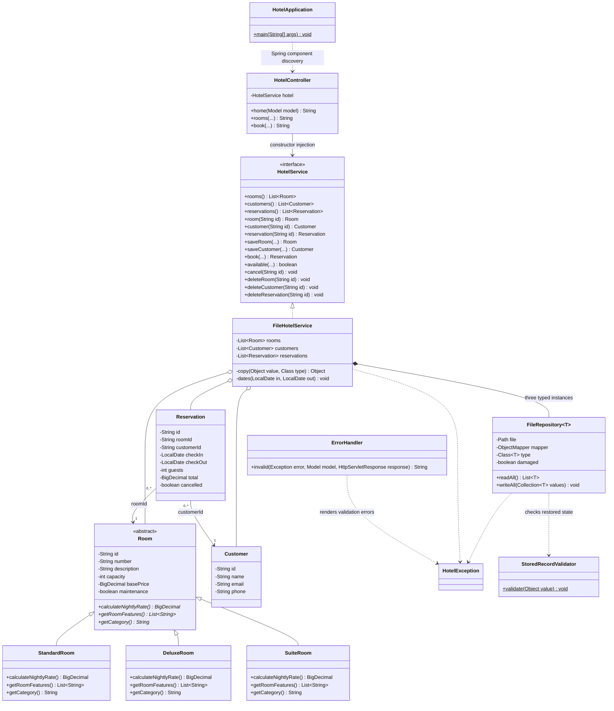

# Implemented class diagram

The Room, Customer and Reservation classes also provide no-argument constructors, full constructors and getters/setters for their private state. Room's constructors are protected. Only representative controller methods are shown; the complete route inventory is in README. Reservation associations use stable IDs rather than nested copies, so guest edits appear in booking views without duplicating guest data. `FileRepository<T>` handles three entity types without repeating file I/O code.
