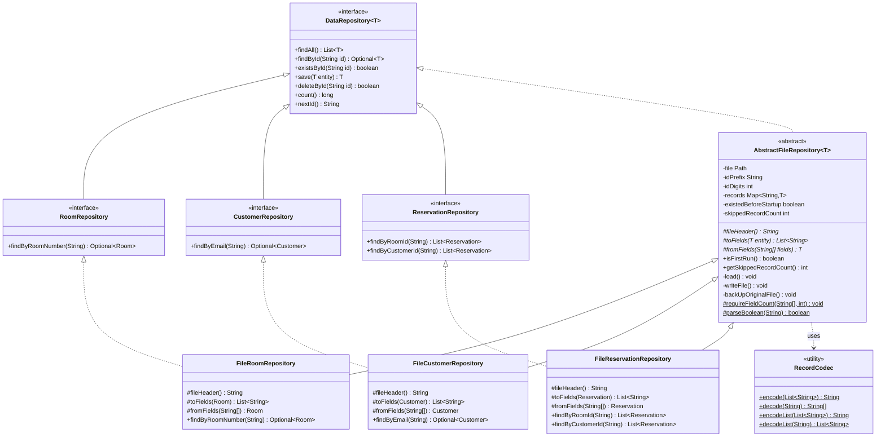
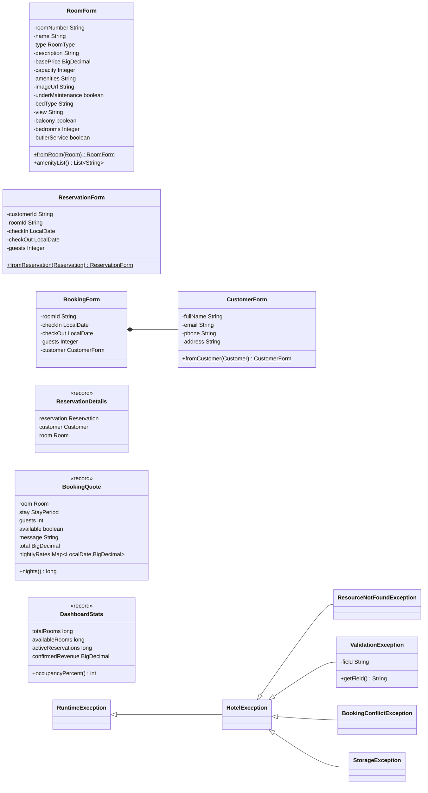

# UML Class Diagrams

These diagrams are drawn from the source code in `src/main/java/com/hotel/reservation`. Every class, attribute and method shown exists in the code. Simple getters and setters are left out to keep the diagrams readable. They render on GitHub and in VS Code with a Mermaid preview extension.

Notation: `+` public, `-` private, `#` protected, `*` abstract, `$` static. A hollow triangle means inheritance or interface realisation; a filled diamond means composition.

---

## 1. Domain model (package `model`)

**How to read it**
- `Room` is abstract (italic or `<<abstract>>`). Its three abstract methods are implemented differently by each subclass. `calculateStayCost()` is a `final` method that calls `calculateNightlyRate()`, so the subclass decides the price at runtime.
- A `Reservation` **composes** a `StayPeriod`: the stay has no meaning outside its reservation.
- A `Reservation` is **associated** with one `Customer` and one `Room` through their IDs, which is how the records are linked in the text files. A customer or room can have many reservations.

---

## 2. Persistence layer (package `repository`)

`AbstractFileRepository<T>` follows the **Template Method** pattern. It implements loading, saving, safe file replacement and ID generation once. Each subclass only supplies `fileHeader()`, `toFields()` and `fromFields()`.

---

## 3. Services, controllers and their dependencies

All dependencies are passed in through constructors (constructor-based dependency injection). Services depend only on the repository **interfaces**, never on the `File...Repository` classes.

---

## 4. Form objects, view records and exceptions

`DashboardStats` has more numeric fields than shown (`roomsUnderMaintenance`, `totalCustomers`, `totalReservations`, `cancelledReservations`, `arrivalsToday`, `occupiedTonight`). They are omitted here for space.
